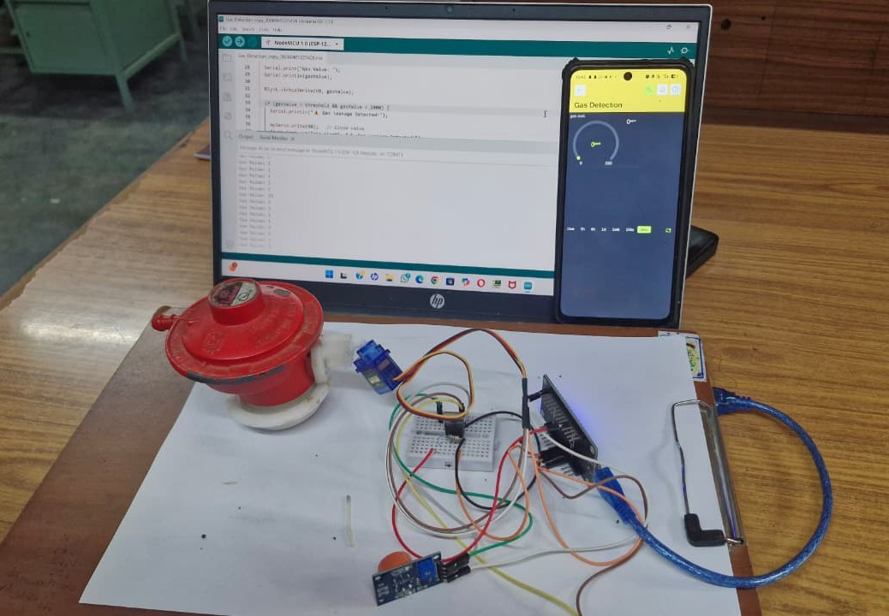
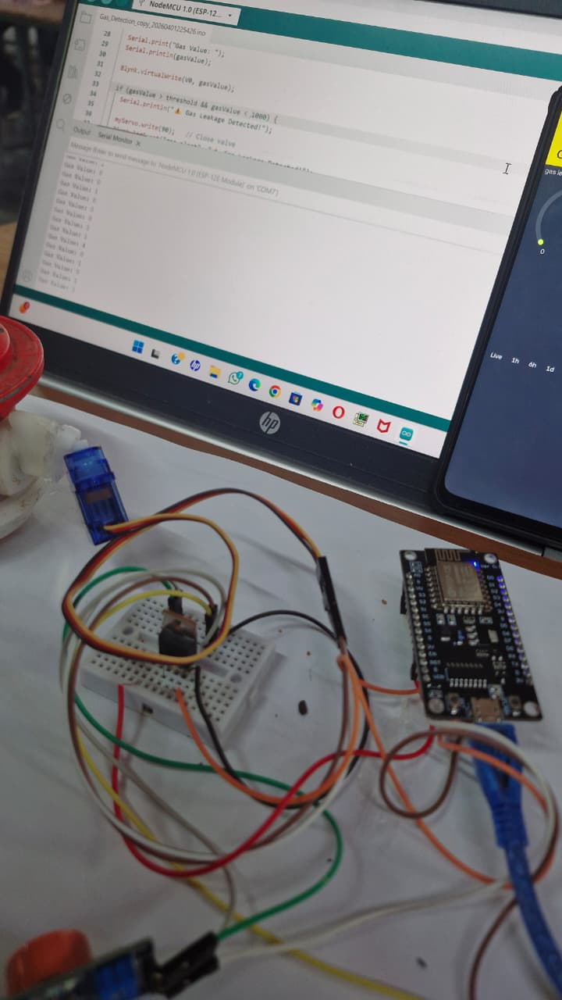

# LPG Gas Leakage Detection and Automatic Cut-Off System

An IoT-enabled LPG safety system: a NodeMCU (ESP8266) reads a gas sensor, streams live readings to a Blynk mobile dashboard, and automatically closes the gas regulator with a servo motor when a leak is detected.

   

> Final-year project, B.Tech Electronics and Communication Engineering, Mohan Babu University, Tirupati.

<p align="center">
  
  <br>
  <em>Working prototype: NodeMCU, gas sensor, servo-actuated regulator and Blynk dashboard</em>
</p>

## Motivation

LPG is heavier than air and settles near the floor, and people may not notice a leak while asleep, away from home, or with a reduced sense of smell. This project provides an affordable, always-on system that warns the user remotely and shuts off the gas without waiting for a human response.

## How It Works

1. The gas sensor continuously measures gas concentration near the cylinder.
2. The NodeMCU reads the value and sends it to the Blynk mobile app, which shows a live gauge and history.
3. The same reading is printed on the serial monitor for debugging.
4. When the reading crosses the leak threshold, the firmware reports "Gas Leakage Detected!" and turns a servo motor to close the regulator valve.

```
Gas sensor --> NodeMCU (ESP8266) --Wi-Fi--> Blynk mobile dashboard
                     |
                     +--> Servo motor --> Gas regulator (valve closed on leak)
```

## Hardware

| Component | Function |
|---|---|
| NodeMCU (ESP8266) | Reads the sensor, connects over Wi-Fi, controls the servo |
| MQ-series gas sensor module | Detects LPG and related combustible gases |
| Micro servo motor | Turns the regulator knob to cut off the gas |
| Breadboard and jumper wires | Circuit connections |
| USB power supply | Powers the board |
| LPG regulator | Demonstrates the shut-off mechanism |

**Software:** Arduino IDE, Blynk IoT platform.

## Prototype

| Firmware and dashboard | Circuit |
|---|---|
|  |  |

## Setup

1. Install the Arduino IDE, the ESP8266 board package, and the Blynk and Servo libraries.
2. Open `firmware/gas_leak_detector/gas_leak_detector.ino`.
3. Set your Wi-Fi name, Wi-Fi password and Blynk auth token at the top of the sketch.
4. Select the NodeMCU 1.0 (ESP-12E) board and upload.
5. Create a Blynk dashboard with a gauge on virtual pin V0 to see live readings.

## Design Considerations (from the project report)

The report describes the system as sense, decide and act. It also proposes a buzzer and LED for a local alarm, a relay-driven cut-off, and optional GSM or Bluetooth alerts. The built prototype uses a servo for the shut-off and Blynk over Wi-Fi for remote alerts.

## Applications

Domestic kitchens, restaurants and canteens, hostels, LPG storage points, small industrial units and laboratories.

## Limitations

- Semiconductor gas sensors also respond to other gases and vapours
- Readings drift with temperature and humidity and need periodic calibration
- Remote alerts depend on Wi-Fi and internet availability
- A servo on the regulator knob is a demonstration mechanism, not a certified safety shut-off
- Test results for real leak conditions are not documented

## Future Scope

- Buzzer and LED local alarm, and push or SMS notifications
- Motorised or solenoid valve for a more robust shut-off
- Exhaust fan control
- Battery backup for power failures
- Second sensor or temperature and humidity compensation to reduce false alarms

## References

- Hanwei Electronics, MQ-series sensor datasheets
- Blynk documentation
- ESP8266 Arduino core documentation

## Author

Konduru Mounika, Department of Electronics and Communication Engineering, Mohan Babu University, Tirupati, Andhra Pradesh
